# LifeLink: Emergency Blood Donation & Medical Reserve Network 🩸

[](https://nodejs.org/)
[](https://react.dev/)
[](https://vitejs.dev/)
[](https://tailwindcss.com/)
[](https://www.mongodb.com/)
[](https://firebase.google.com/)
[](https://jestjs.io/)
[](https://www.w3.org/WAI/standards-guidelines/wcag/)

LifeLink is an emergency response web application powered by **MongoDB (Mongoose)** and **Express.js / React**, using **Firebase Auth strictly for Google Sign-In**. It bridges standby blood donors, individuals in critical need, and medical facilities through smart donor matching, real-time inventory management, spatial UI design, and role-based workflows.

> [!WARNING]
> **Security Note:** Real credentials and `.env` files are never committed to GitHub. Copy `.env.example` templates to `.env` in both `server/` and `client/` directories and configure your credentials locally.

---

## 🚀 Key Capabilities

- 📍 **Smart Donor Matching Engine**: In-code spatial distance calculation and compatibility matrix ranking standby donors based on ABO/Rh RBC compatibility, 90-day donation cooldown eligibility (anchored to actual collection dates), proximity distance, and availability.
- ⚡ **Emergency Request Broadcast & Tracking**: Instant creation of emergency blood requests (`/individual/create`) with live matched donor rankings and automated notification dispatch. Recipients can monitor progress in real time via an interactive stepper tracking portal (`/individual/track/:id`).
- 🏥 **Hospital Command Hub & Reserve Stock**: Medical facilities manage reserve stock across all 8 standard blood groups, process incoming requests, allocate inventory units, inspect transaction ledgers, and verify collections via an interactive **Confirm Donation** dialog with date validation.
- 👤 **Donor Portal & Google Sign-In**: Standby donors manage availability, view three-date donation history (`pledgedAt`, `donatedAt`, `confirmedAt`) and live cooldown countdowns, and authenticate via traditional credentials or verified Google Single Sign-On (Firebase Auth ID Token verification).
- 🛡️ **Role-Based Access Control**: Strict JWT authentication with distinct access controls for standard `user` (donor & recipient), verified `hospital`, and system `admin`.
- 💎 **Warm Nocturne Glass & Spatial UI**: Tactile editorial translucent UI pairing matte charcoal dark mode (`#141210`) and warm cream alabaster light mode (`#FAF7F2`) with 5 spatial elevation tiers, subtle radial ambient glows, dynamic refraction filters, and Coral Ember focus rings.
- 📊 **AI Insights & Platform Analytics**: Administrative dashboard with Recharts analytics visualizations, emergency response indicators, shortage prediction alerts, and a role-aware, read-only AI Assistant chatbot.
- 🧪 **Comprehensive Automated Testing & QA**: 377 automated Jest + Supertest backend tests (31 test suites, 100% pass) alongside automated WCAG 2.1 AA/AAA contrast checks and Playwright visual audits.

---

## 📸 Application Showcase & Deep Visual Walkthrough

Interactive captures taken directly from the live running client (`1440×900` `@2x`) across both **Dark (Warm Nocturne)** and **Light (Warm Cream Alabaster)** themes — spanning public discovery, onboarding, donor workflows, recipient request tracking, hospital blood bank operations, admin analytics, and the role-aware AI Assistant.

### 1. Public Discovery, Theme Parity & Authentication

<table>
  <tr>
    <td width="50%" valign="top">
      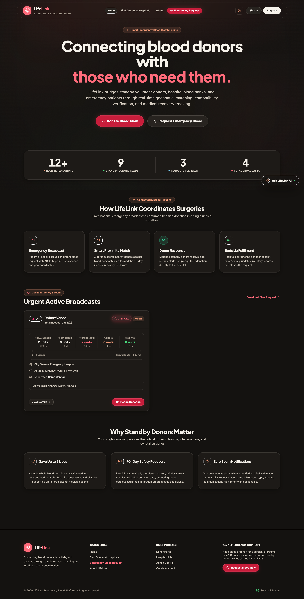
      <br />
      <strong>Landing &amp; Emergency Network (Dark — Warm Nocturne)</strong><br />
      Matte studio charcoal (<code>#141210</code>) hero, 4 live network telemetry stats, 4-step workflow pipeline, urgent broadcast feed, and specular glass navigation.
    </td>
    <td width="50%" valign="top">
      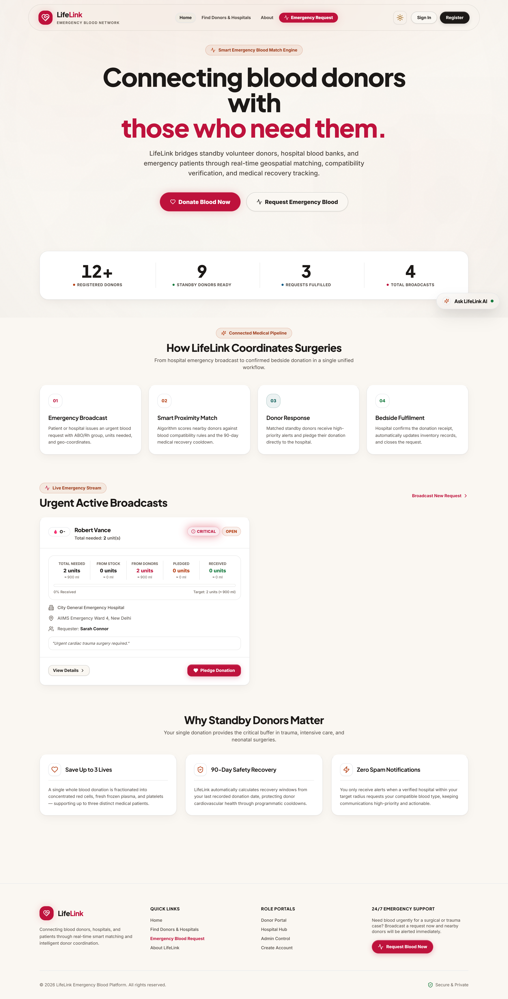
      <br />
      <strong>Landing &amp; Emergency Network (Light — Warm Cream Alabaster)</strong><br />
      Warm cream foundation (<code>#FAF7F2</code>) with crisp porcelain surfaces (<code>#FFFFFF</code>), espresso typography (<code>#1C1917</code>), and preserved 10% emergency crimson hierarchy.
    </td>
  </tr>
  <tr>
    <td width="50%" valign="top">
      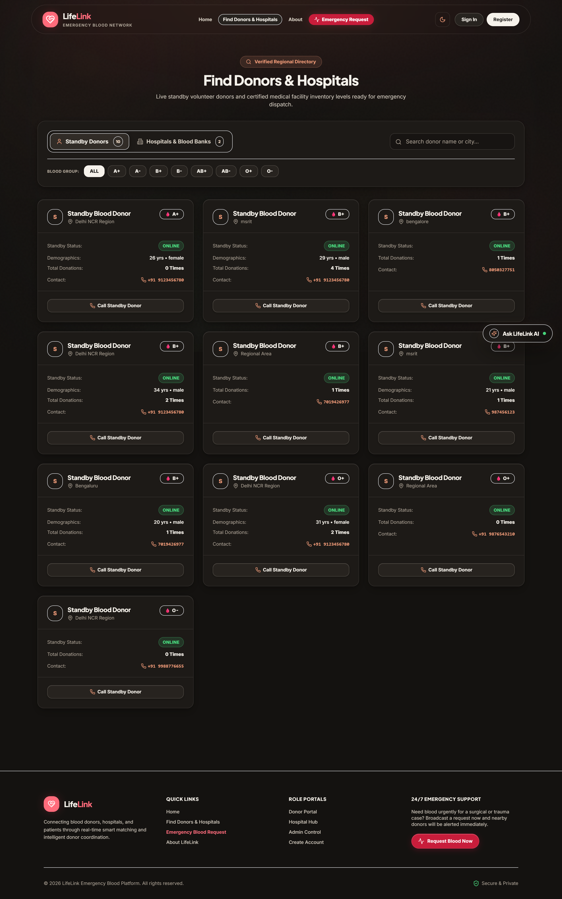
      <br />
      <strong>Standby Donor Directory (<code>/find-donors</code>)</strong><br />
      Search and filter verified standby donors by blood group (O-, B+, AB+, etc.) and availability status with privacy-preserving profiles.
    </td>
    <td width="50%" valign="top">
      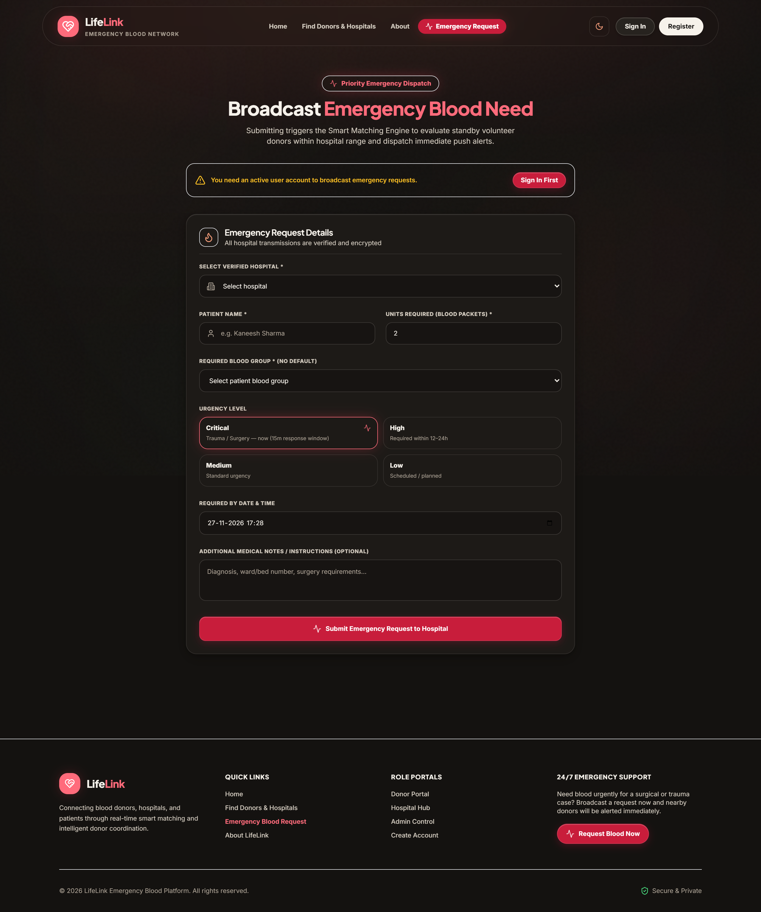
      <br />
      <strong>Emergency Request Dispatch (<code>/emergency-request</code>)</strong><br />
      Urgent request dispatch form supporting patient details, required blood group, RBC unit count, urgency tier, and medical facility location.
    </td>
  </tr>
  <tr>
    <td width="50%" valign="top">
      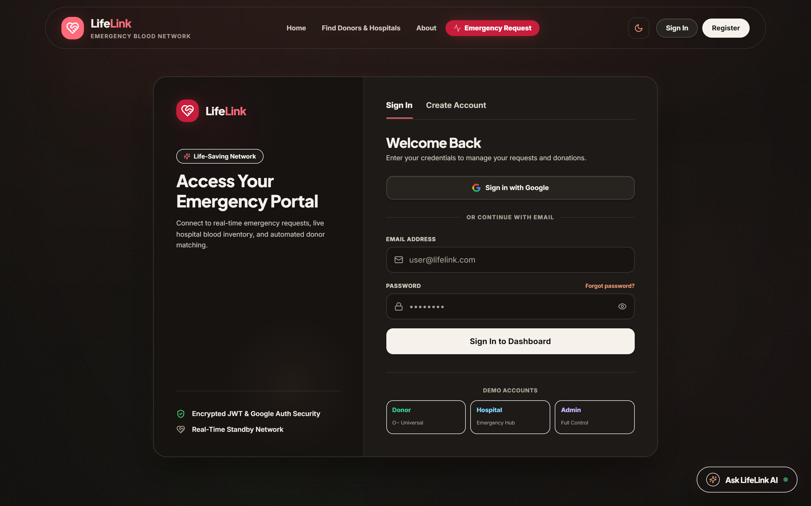
      <br />
      <strong>Authentication &amp; Google SSO (<code>/login</code>)</strong><br />
      Email/password authentication, Firebase Google Sign-In integration, and one-click seeded role credentials for Donor, Hospital, and Admin testing.
    </td>
    <td width="50%" valign="top">
      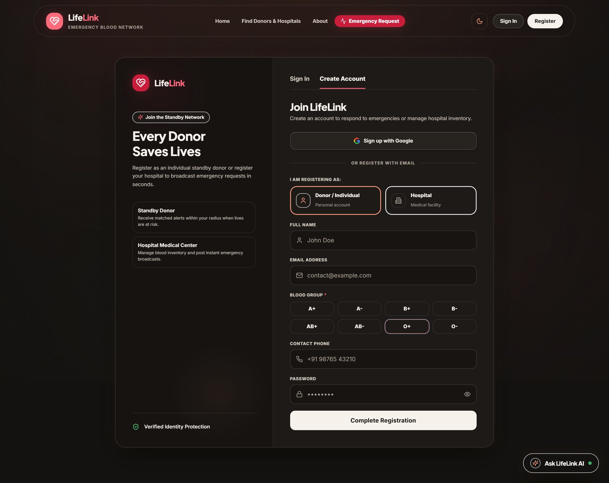
      <br />
      <strong>Role-Aware Onboarding (<code>/register</code>)</strong><br />
      Unified registration flow supporting Individual Donors (with ABO blood group selector pills) and Hospital / Blood Bank verification requests.
    </td>
  </tr>
</table>

### 2. Donor Portal, Cooldown Eligibility & Donation Date Lifecycle

<table>
  <tr>
    <td width="50%" valign="top">
      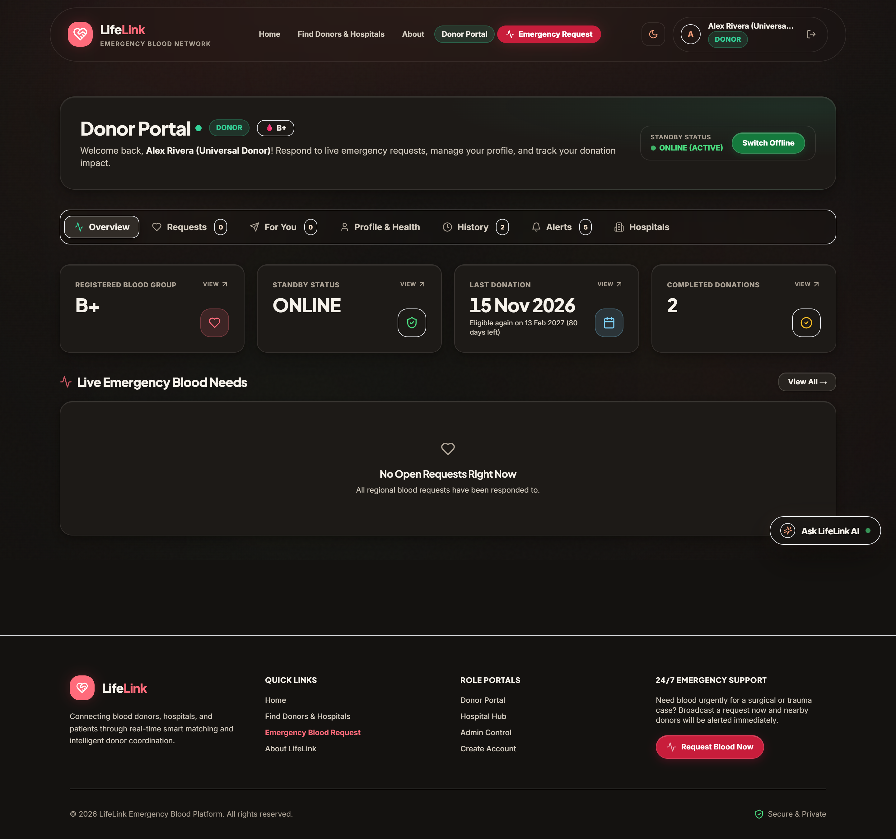
      <br />
      <strong>Donor Overview &amp; Cooldown Status (Dark)</strong><br />
      Displays live <code>ONLINE</code> availability, <code>Last Donation: 15 Nov 2026</code> anchored to actual <code>donatedAt</code>, and computed countdown <code>Eligible again on 13 Feb 2027 (80 days left)</code>.
    </td>
    <td width="50%" valign="top">
      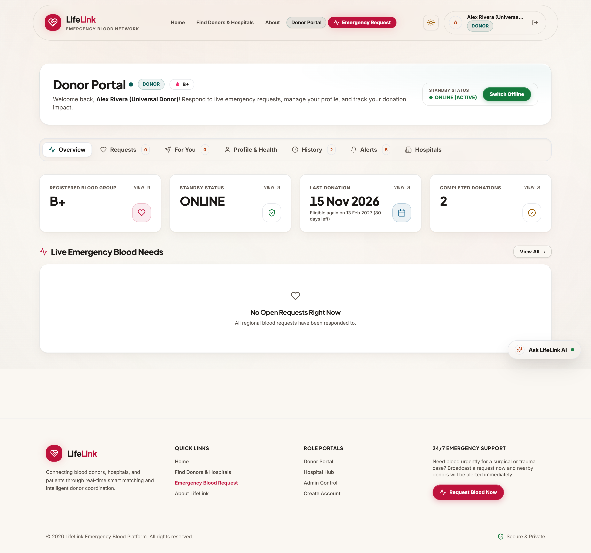
      <br />
      <strong>Donor Overview &amp; Cooldown Status (Light)</strong><br />
      Full visual parity in Warm Cream Alabaster mode across overview telemetry tiles, request cards, and quick navigation shortcuts.
    </td>
  </tr>
  <tr>
    <td width="50%" valign="top">
      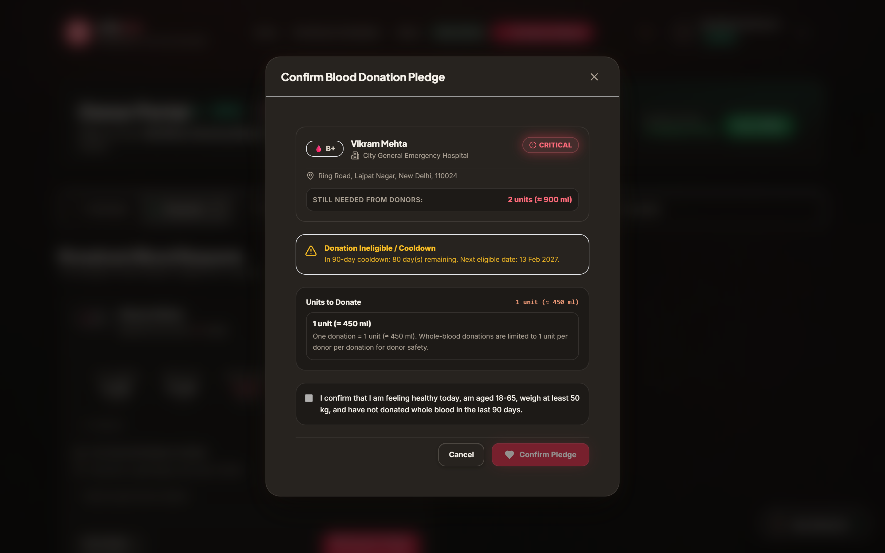
      <br />
      <strong>Safe Pledge Modal (<code>PledgeModal.jsx</code>)</strong><br />
      Shows volumetric shortfall (<code>2 units (≈ 900 ml)</code>), real-time 90-day cooldown enforcement (disabling pledge during cooldown), 1-unit cap, and mandatory health affirmation.
    </td>
    <td width="50%" valign="top">
      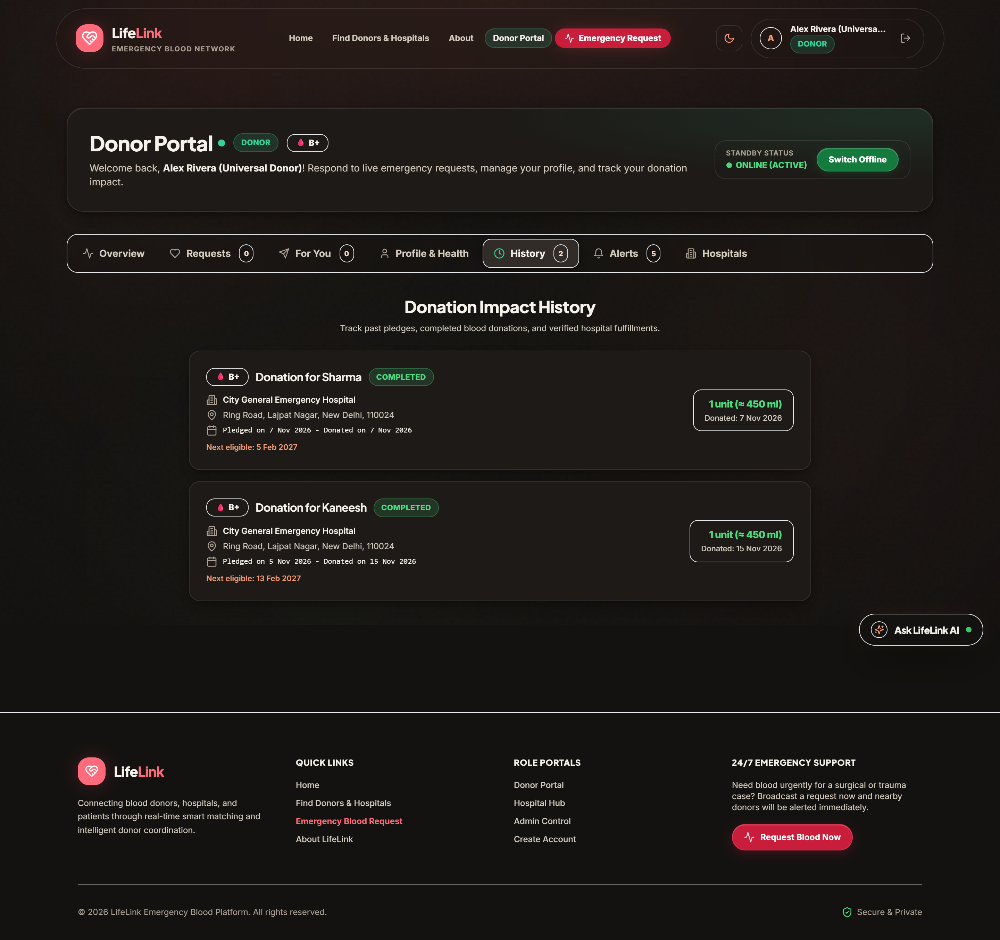
      <br />
      <strong>Donation History &amp; Three-Date Cards (<code>DonationHistoryCard.jsx</code>)</strong><br />
      Distinguishes <code>Pledged on 5 Nov 2026 - Donated on 15 Nov 2026</code> with <code>Next eligible: 13 Feb 2027</code> and right-hand <code>1 unit (≈ 450 ml)</code> + <code>Donated: 15 Nov 2026</code> labels.
    </td>
  </tr>
  <tr>
    <td width="50%" valign="top">
      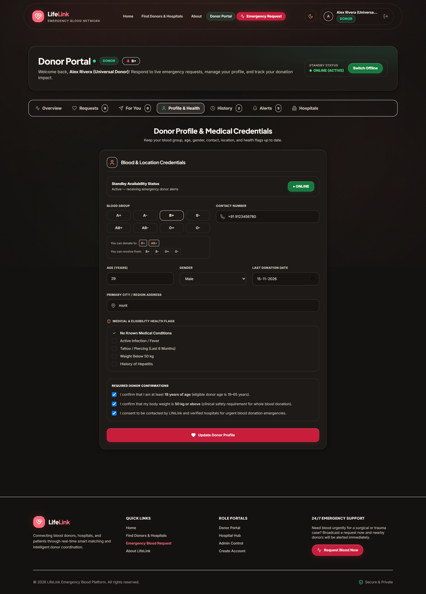
      <br />
      <strong>Donor Profile &amp; Clinical Readiness (<code>?tab=profile</code>)</strong><br />
      Live standby toggle, interactive ABO/Rh group selector with compatible recipient strip, city/coordinates metadata, and health screening notes.
    </td>
    <td width="50%" valign="top">
      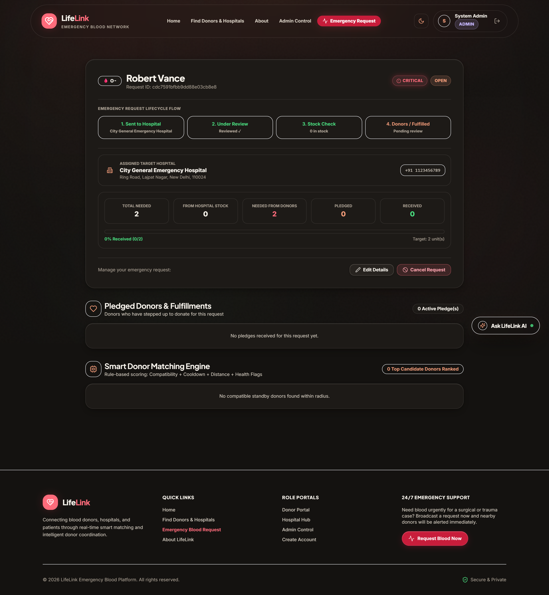
      <br />
      <strong>Emergency Request Tracker &amp; Match Engine (<code>/individual/track/:id</code>)</strong><br />
      Real-time 4-stage lifecycle progress bar (Created &rarr; Searching &rarr; Partially Fulfilled &rarr; Fulfilled), unit breakdown bar, pledged donor ledger, and the Smart Donor Matching Engine panel.
    </td>
  </tr>
</table>

### 3. Hospital Command Center, Confirm Donation Dialog & Blood Ledger

<table>
  <tr>
    <td width="50%" valign="top">
      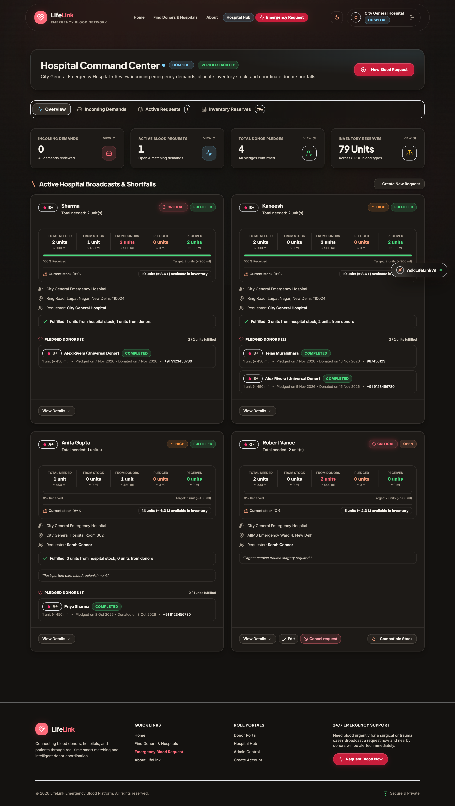
      <br />
      <strong>Hospital Command Center (<code>/hospital/dashboard?tab=overview</code>)</strong><br />
      Facility RBC total (79 Units), urgent emergency broadcasts, recent pledge activity displaying <code>Pledged on &hellip; &bull; Donated on &hellip;</code> and <code>Released on &hellip;</code> states.
    </td>
    <td width="50%" valign="top">
      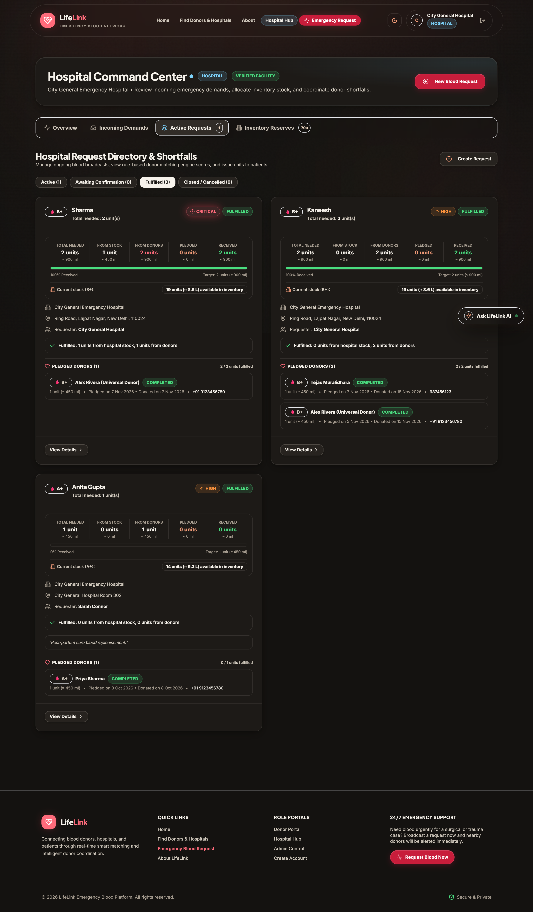
      <br />
      <strong>Fulfilled &amp; Released Pledges Audit (<code>?tab=active</code>)</strong><br />
      Unified view of completed collections (e.g. <code>Pledged on 7 Nov 2026 &bull; Donated on 18 Nov 2026</code>) and released donor pledges.
    </td>
  </tr>
  <tr>
    <td width="50%" valign="top">
      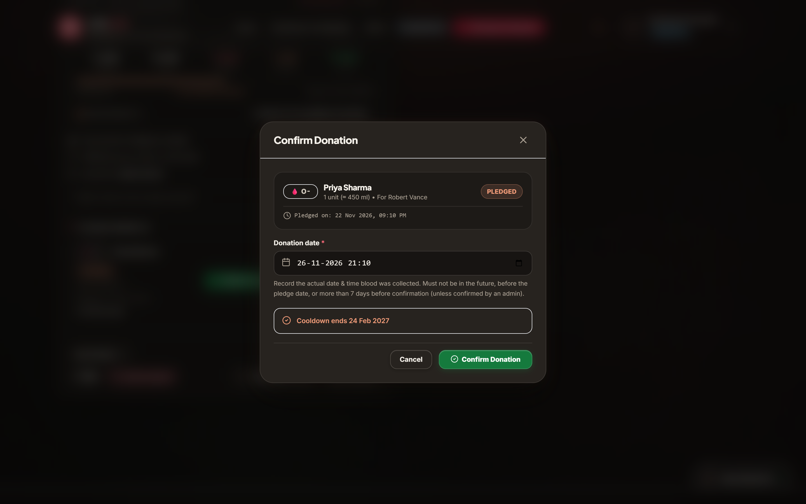
      <br />
      <strong>Confirm Donation Dialog (<code>ConfirmDonationModal.jsx</code>)</strong><br />
      Replaced one-click confirmation with explicit <code>Donation date *</code> input, server/client validation (no future dates, not before pledge date, 7-day backdate limit for hospitals), and live <code>Cooldown ends 24 Feb 2027</code> preview.
    </td>
    <td width="50%" valign="top">
      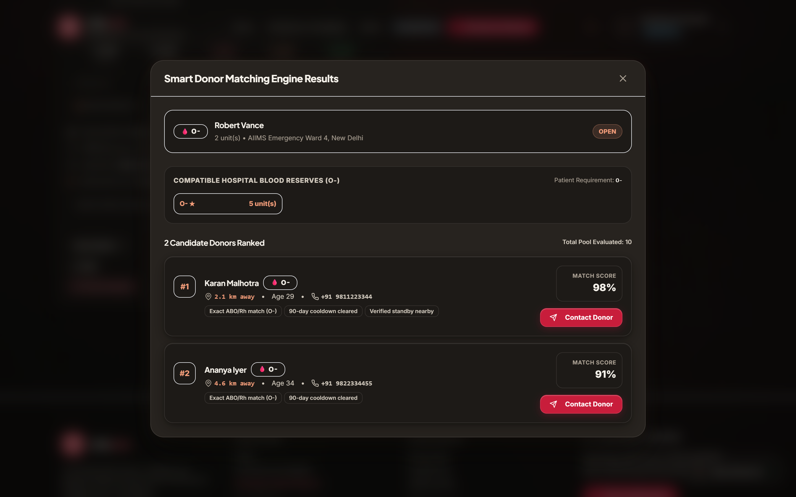
      <br />
      <strong>Hospital Smart Matching Modal</strong><br />
      Displays compatible in-house blood bank reserves (<code>O- 5 unit(s)</code>) alongside ranked standby donors scored by compatibility, cooldown status, and distance.
    </td>
  </tr>
  <tr>
    <td colspan="2" align="center">
      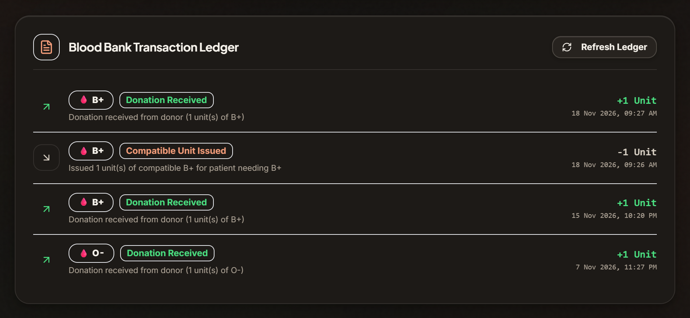
      <br />
      <strong>Blood Bank Transaction Ledger (<code>?tab=inventory</code>)</strong> &mdash; Atomic ledger tracking every <code>+1 Unit</code> verified donation receipt and <code>-1 Unit</code> direct/compatible patient transfusion issuance with timestamps.
    </td>
  </tr>
</table>

### 4. Admin Governance, Recharts Analytics & AI Insights

<table>
  <tr>
    <td width="50%" valign="top">
      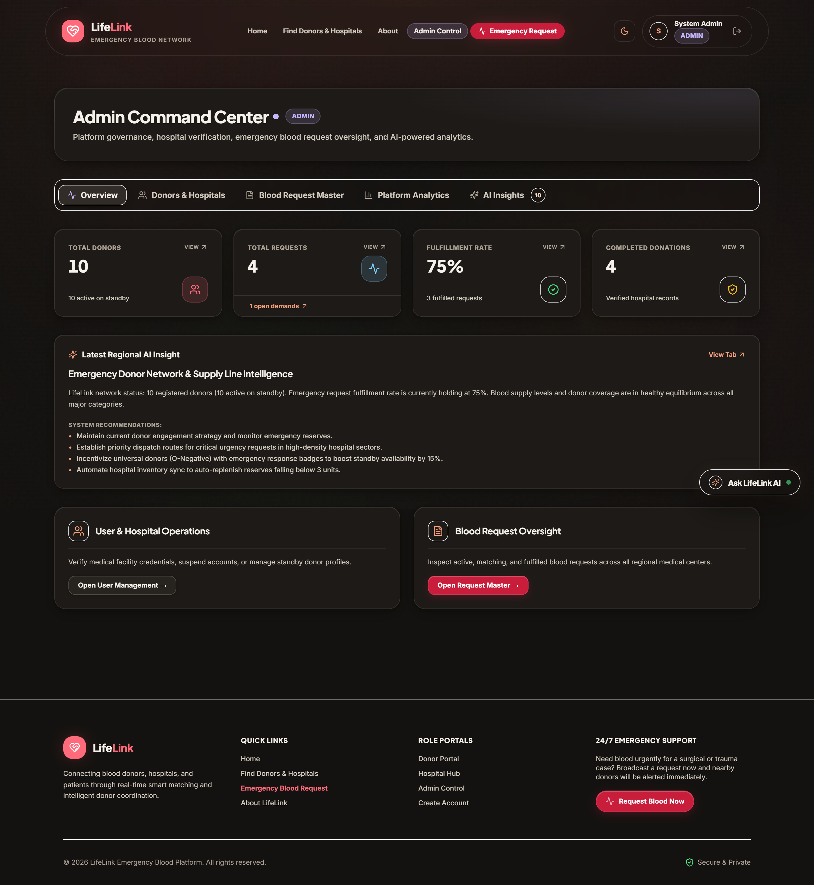
      <br />
      <strong>Admin Overview &amp; Telemetry (<code>/admin/dashboard</code>)</strong><br />
      Platform KPI cards (total donors, verified hospitals, active emergencies, total requests) and pinned latest Regional AI Narrative Insight.
    </td>
    <td width="50%" valign="top">
      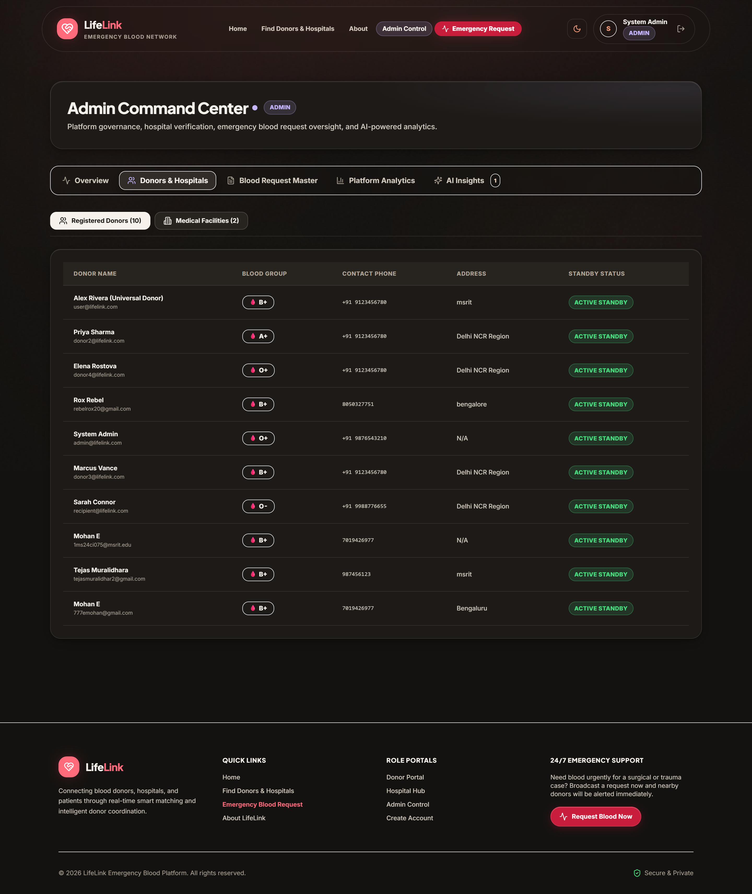
      <br />
      <strong>Donors &amp; Hospital Verification Directory (<code>?tab=users</code>)</strong><br />
      Account governance table tracking donor blood types, last donation records, role badges, and facility approval workflow.
    </td>
  </tr>
  <tr>
    <td width="50%" valign="top">
      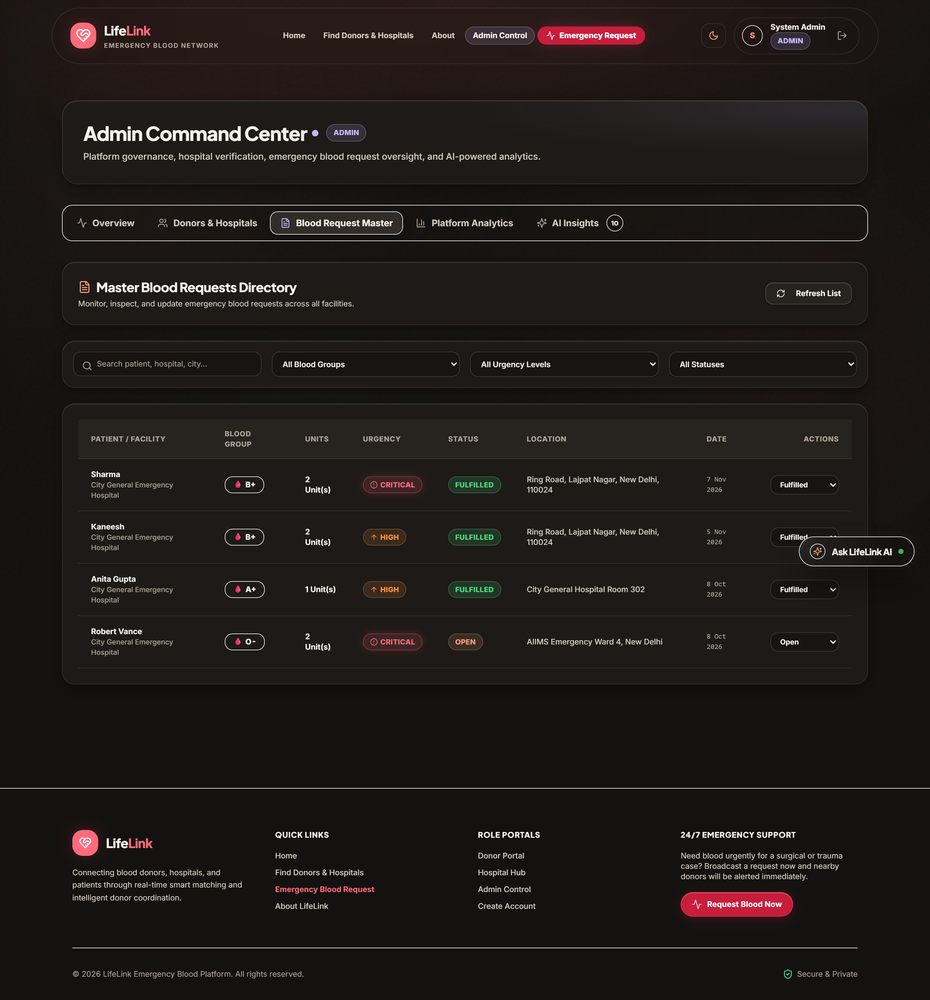
      <br />
      <strong>Master Blood Requests Directory (<code>?tab=requests</code>)</strong><br />
      Full network audit table of active and fulfilled blood requests with blood group pills, units fulfilled, urgency chips, and hospital locations.
    </td>
    <td width="50%" valign="top">
      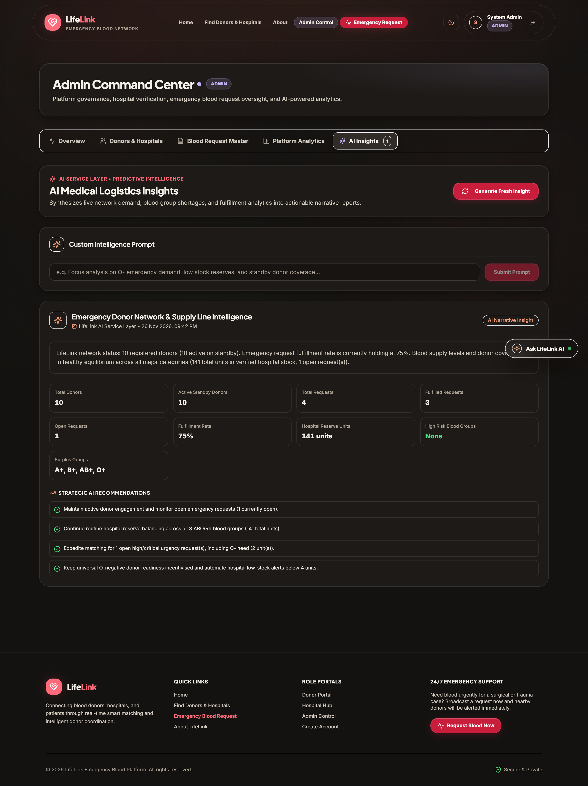
      <br />
      <strong>AI Medical Logistics Insights (<code>?tab=ai-insights</code>)</strong><br />
      On-demand Gemini synthesis with custom trend prompt input, shortage risk analysis, and historical narrative report cards.
    </td>
  </tr>
  <tr>
    <td width="50%" valign="top">
      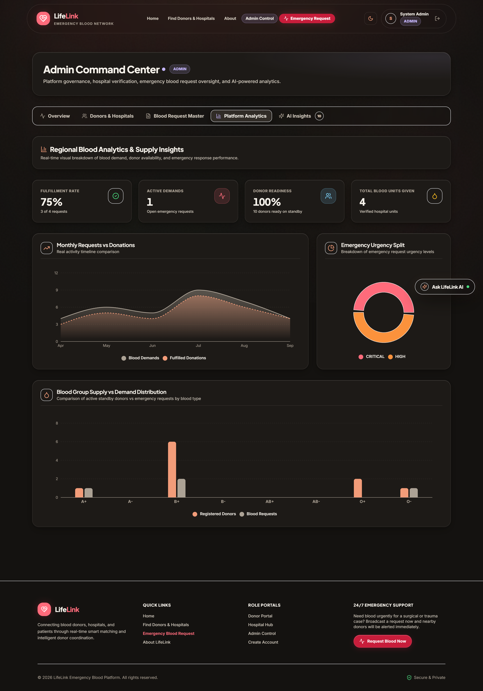
      <br />
      <strong>Platform Analytics Charts (Dark &mdash; Warm Nocturne)</strong><br />
      Recharts Monthly Requests vs. Donations area plot, Emergency Urgency Split donut, and Blood Group Supply vs. Demand bars using Coral/Sage/Amber/Violet series.
    </td>
    <td width="50%" valign="top">
      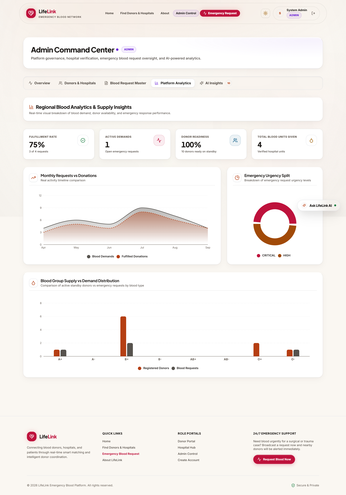
      <br />
      <strong>Platform Analytics Charts (Light &mdash; Warm Cream Alabaster)</strong><br />
      High-contrast light chart palette (<code>#C2410C</code>, <code>#0F766E</code>, <code>#A14A08</code>, <code>#6D28D9</code>) paired cleanly via <code>useChartTheme</code>.
    </td>
  </tr>
</table>

### 5. Role-Aware LifeLink AI Assistant (Dark & Light)

<table>
  <tr>
    <td width="50%" valign="top">
      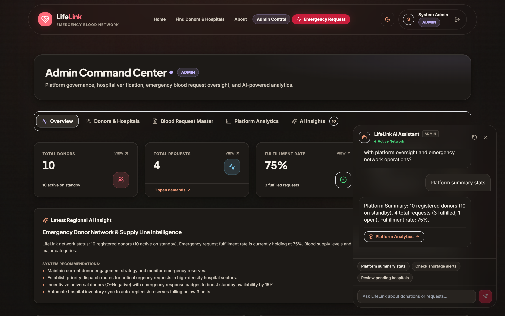
      <br />
      <strong>Admin AI Assistant (Dark)</strong><br />
      Answers platform summary queries via read-only <code>getPlatformStats</code> tool calls with live MongoDB counts and a deep-link <code>Platform Analytics &rarr;</code> CTA button.
    </td>
    <td width="50%" valign="top">
      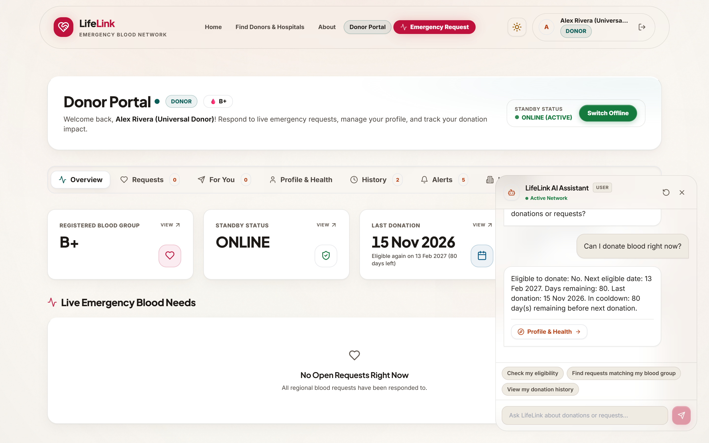
      <br />
      <strong>Donor Eligibility AI Assistant (Light)</strong><br />
      Evaluates 90-day cooldown directly from <code>donatedAt</code> (<code>15 Nov 2026</code> &rarr; next eligible <code>13 Feb 2027</code>, <code>80 days remaining</code>) and links to <code>Profile &amp; Health &rarr;</code>.
    </td>
  </tr>
</table>

---

## 🎨 Liquid Glass & Spatial UI Design System

LifeLink features a bespoke **"Warm Nocturne + Vital Rose-Crimson + Coral Ember"** design system tailored for high-stakes medical coordination — replacing cold, glary blacks and blues with tactile warm charcoal in dark mode, warm cream alabaster in light mode, and strict accessible contrast:

- **Warm Nocturne + Vital Crimson + Coral Ember Direction**:
  - **Tactile Editorial Precision**: Matte Warm Charcoal (`#141210`) with smoked espresso-slate cards (`#1D1A17`) in dark mode, and Warm Cream Alabaster (`#FAF7F2`) with pure porcelain cards (`#FFFFFF`) in light mode.
  - **10% Emergency Crimson Budget**: Vital Rose-Crimson (`#C81D3B` / `#FF6B7B` dark; `#BE123C` light) is reserved strictly for life-critical signals (primary emergency CTAs, critical badges, urgent request status indicators, active alerts). It represents $\le 10\%$ of any viewport, preserving instant urgency.
  - **Semantic Mapping**: ONLINE / Verified Facility / Confirmed / Fulfilled $\rightarrow$ `success`; cooldown / low stock / pending $\rightarrow$ `warning`; critical stock / urgent request $\rightarrow$ `danger`; Coral Ember / Terracotta informational highlights & keyboard focus $\rightarrow$ `info / focus`. Always paired with icons and text labels (never color alone).

### Semantic Design Tokens & Extended Accents (Single Source of Truth)

| Token | Dark Mode | Light Mode | Usage & Purpose |
|---|---|---|---|
| `canvas` | `#141210` | `#FAF7F2` | Base viewport foundation |
| `surface` | `#1D1A17` | `#FFFFFF` | Core data cards, inputs, containers |
| `raised` | `#27231F` | `#F0EBE2` | Filter panels, interactive forms, active cards |
| `overlay` | `#312C27` | `#FFFFFF` + shadow | Dialog modals, full-screen sheets |
| `text-primary` | `#F6F2EB` | `#1C1917` | High-contrast headings and key data values |
| `text-muted` | `#ACA295` | `#635A52` | Captions, secondary subtitles, metadata |
| `hairline` | `rgba(255,245,235,0.10)` | `rgba(28,25,23,0.10)` | Subtle warm borders and divider lines |
| `specular rim` | `rgba(255,248,240,0.12)` | `rgba(255,255,255,0.96)` | Top-edge optical specular highlight |
| `danger` (text/icon/badge) | `#FF6B7B` | `#BE123C` | Critical shortages, emergency request badges |
| `danger-solid` (button fill) | `#C81D3B` | `#BE123C` | Primary emergency CTAs with white text |
| `danger hover` | `#E11D48` | `#9F1239` | Interactive hover state for danger buttons |
| `danger pressed` | `#9F1239` | `#881337` | Pressed active state for danger buttons |
| `success` | `#4ADE80` | `#157A3D` | ONLINE status, verified facilities, fulfilled donations |
| `warning` | `#FBBF24` | `#9A5B00` | Cooldown warnings, low stock, pending reviews |
| `info / focus` | `#F29C79` | `#B53E12` | Keyboard focus ring (2px Coral Ember / Terracotta), info pills |
| `ice` (warm parchment highlight) | `#F6DFC9` | `#1C1917` | Soft secondary highlights and subtle glow accents |
| `accent-donor` | `#34D399` | `#0B5E58` | Donor portal title dot, hero tint, tab indicator |
| `accent-hospital` | `#7DD3FC` | `#075985` | Hospital command center title dot, hero tint, tab indicator |
| `accent-admin` | `#C4B5FD` | `#6D28D9` | Admin governance center title dot, hero tint, tab indicator |
| `urgency-critical` | `#FF6B7B` | `#BE123C` | Emergency shortage chip (`AlertCircle` icon + `Critical` label) |
| `urgency-high` | `#FB923C` | `#A14A08` | High urgency chip (`ArrowUp` icon + `High` label) |
| `urgency-medium` | `#FBBF24` | `#9A5B00` | Medium urgency chip (`Minus` icon + `Medium` label) |
| `urgency-low` | `#7DD3FC` | `#0369A1` | Low urgency chip (`ArrowDown` icon + `Low` label) |
| `abo-o` | `#34D399` | `#0B5E58` | O family blood pills (O+ subtle fill, O- outlined) |
| `abo-a` | `#7DD3FC` | `#075985` | A family blood pills (A+ subtle fill, A- outlined) |
| `abo-b` | `#C4B5FD` | `#6D28D9` | B family blood pills (B+ subtle fill, B- outlined) |
| `abo-ab` | `#FBBF24` | `#9A5B00` | AB family blood pills (AB+ subtle fill, AB- outlined) |
| `chart-series (1-6)` | `#F29C79`, `#34D399`, `#FBBF24`, `#C4B5FD`, `#FF6B7B`, `#ACA295` | `#C2410C`, `#0F766E`, `#A14A08`, `#6D28D9`, `#BE123C`, `#57534E` | Recharts series colors across dark &amp; light palettes |

- **5-Tier Spatial Elevation System**:
  - `elevation-canvas` (Level 0): Viewport foundation and atmospheric canvas.
  - `elevation-base` (Level 1): Standard data cards, list tiles, and tabular rows.
  - `elevation-raised` (Level 2): Active items, interactive forms, and filter panels.
  - `elevation-floating` (Level 3): Floating navigation bar, AI chat widget, and toast alerts.
  - `elevation-overlay` (Level 4): High-priority dialog modals and full-screen drawers.
- **Atmospheric Canvas**: 4 subtle radial ambient glows (Warm Coral Ember `rgba(232,106,80,0.085)`, Soft Rose Signal `rgba(217,59,78,0.06)`, Soft Sage Glow `rgba(74,222,128,0.04)`, and Warm Sand Tint `rgba(251,191,36,0.035)`) kept subtle in dark mode with `prefers-reduced-motion` fallback.
- **Optics & Refraction**: Warm charcoal glass (`rgba(29,26,23,0.90)`) with soft espresso depth shadows (`--shadow-card`, `--shadow-elevated`) in dark mode, clean porcelain glass (`rgba(255,255,255,0.88)`) with warm elevation shadows (`0 1px 2px rgba(28,25,23,.04), 0 8px 24px -4px rgba(28,25,23,.06)`) in light mode, SVG displacement map filters (`#liquid-refraction`), and top specular rims.
- **Accessibility & Contrast**: Automated WCAG 2.1 AA/AAA compliance verified across all routes and state views in both dark and light modes via `check-contrast.js` and `audit-pages.js`, with tabular numeric fonts (`tabular-nums`) preventing layout shifts.

---

## 🛠️ Technology Stack

| Layer | Technologies |
|---|---|
| **Frontend** | React 18, Vite 5, Tailwind CSS 3, Framer Motion, Lucide Icons, Recharts, Axios |
| **Backend** | Node.js, Express.js 4, Mongoose 9, `firebase-admin` 14 (Google SSO only), JWT, bcryptjs, Zod validation |
| **Database & Cloud** | MongoDB + Mongoose (Uniform Repository Architecture, replica-set transactions) |
| **Authentication** | Custom JWT + bcryptjs & Google Login (Firebase Auth ID Token verification) |
| **Testing & QA** | Jest, Supertest, `mongodb-memory-server`, Playwright, `@axe-core/playwright` (377 automated tests) |

---

## 👥 Role Architecture & Account Types

| Role / Account Type | Registration | Key Privileges |
|---|---|---|
| **`user`** (Donor & Recipient) | Public registration / Google Sign-In | Post emergency requests, track request progress, pledge donations, manage availability & donor profile |
| **`hospital`** | Public registration (requires admin approval) | Broadcast emergency requests, manage RBC inventory units, ping matching donors, confirm fulfilled donations |
| **`admin`** | Database seed script | Approve hospital registrations, manage platform users & requests, view AI insights & analytics |

> [!NOTE]
> **Role Elevation Guard:** Google Sign-In strictly provisions accounts with `accountType: "user"`. Hospital and Admin accounts cannot be provisioned via Google Sign-In, protecting elevated system roles.

---

## 🏗️ System Architecture


> High-resolution diagram exports: [Light (Report Print)](docs/figures/light/Fig_3.1_System_Architecture_Diagram.png) • [Dark (Mono Ink)](docs/figures/Fig_3.1_System_Architecture_Diagram.png)

---

## 🗄️ Data Architecture & Lifecycles

LifeLink pairs **MongoDB** (`lifelink` database with Mongoose schemas & replica-set transactions) with Firebase Authentication (**Google Sign-In only**), signed 30-day JWT sessions, and read-only AI tools:
- **Persistence**: 11 MongoDB collections (`users`, `donorprofiles`, `hospitals`, `bloodrequests`, `donations`, `inventorytransactions`, `donorrequestpings`, `notifications`, `aiinsights`, `loginlogs`, `audit_logs`).
- **Security & Privacy**: Passwords hashed with `bcryptjs` (10 rounds); donor contact details (phone, email) strictly masked from public and AI model responses.
- **AI Mesh**: Google Gemini operates exclusively via read-only function tools; conversation history lives ephemerally in React client memory.
- **Detailed Specification & Lifecycle Diagrams**: See [docs/data-model.md](docs/data-model.md) for full collection schemas, the request state machine, and the donor pledge sequence diagram.

---

## 💻 Setup & Installation

### Prerequisites
- [Node.js](https://nodejs.org/) (v18.0.0 or higher) and `npm`
- A **MongoDB** deployment configured as a replica set (MongoDB Atlas or a local `mongod` replica set for multi-document ACID transactions)
- A [Firebase Project](https://console.firebase.google.com/) with **Firebase Authentication (Google Provider)** enabled *(used exclusively for Google Sign-In ID token verification)*

---

### 1. Clone the Repository
```bash
git clone https://github.com/tejas-coder28/LifeLink.git
cd LifeLink
```

---

### 2. Install Dependencies
You can install dependencies for the root, server, and client simultaneously from the repository root:

```bash
# Install all dependencies across client and server
npm run install:all
```

Or install them individually:
```bash
# Server dependencies
cd server
npm install

# Client dependencies
cd ../client
npm install
```

---

### 3. Environment Configuration

#### Backend (`server/.env`)
Copy `server/.env.example` to `server/.env`:
```bash
cp server/.env.example server/.env
```

Generate a Firebase Service Account key (for Google Sign-In verification only):
1. In the [Firebase Console](https://console.firebase.google.com/), navigate to **Project Settings** > **Service accounts**.
2. Click **Generate new private key** and download the resulting JSON file.
3. Save the JSON file securely (e.g. `server/serviceAccountKey.json` — already included in `.gitignore`).
4. Configure `server/.env`:
```env
PORT=5000
MONGODB_URI=mongodb+srv://<username>:<password>@<cluster>.mongodb.net/lifelink?retryWrites=true&w=majority
MONGODB_DB_NAME=lifelink
JWT_SECRET=your_super_secret_jwt_key
FIREBASE_SERVICE_ACCOUNT_PATH=./serviceAccountKey.json
NODE_ENV=development
```

#### Frontend (`client/.env`)
Copy `client/.env.example` to `client/.env`:
```bash
cp client/.env.example client/.env
```

Populate the Firebase Web SDK credentials from **Project Settings** > **General** > **Your apps** > **Web app**:
```env
VITE_API_URL=http://localhost:5000/api
VITE_FIREBASE_API_KEY=your_api_key
VITE_FIREBASE_AUTH_DOMAIN=your_project.firebaseapp.com
VITE_FIREBASE_PROJECT_ID=your_project_id
VITE_FIREBASE_STORAGE_BUCKET=your_project.appspot.com
VITE_FIREBASE_MESSAGING_SENDER_ID=your_sender_id
VITE_FIREBASE_APP_ID=your_app_id
```

---

### 4. Indexes, Seeding & Health Check

Synchronize MongoDB indexes (unique constraints, 2dsphere geo indexes, and TTL indexes):
```bash
npm run indexes:sync --prefix server
```

Seed initial demo accounts and inventory stock:
```bash
# From root
npm run seed

# Or to reset and re-seed clean data
npm run seed:reset
```

Verify backend health:
```bash
# Start backend in development
npm run dev:server
```
Visit `GET http://localhost:5000/api/health` to confirm operational status:
```json
{
  "success": true,
  "status": "connected",
  "dbType": "mongodb",
  "dbName": "lifelink",
  "projectId": "your-firebase-project",
  "timestamp": "..."
}
```

---

### 5. Running the Application

You can run both client and server using the root convenience scripts or dedicated terminals:

#### Option A: Dedicated Terminals (Recommended for Development)
```bash
# Terminal 1 — Start the API Server (Port 5000)
npm run dev:server

# Terminal 2 — Start the React Client (Port 5180)
npm run dev:client
```

#### Option B: From Subdirectories
```bash
# Terminal 1:
cd server && npm run dev

# Terminal 2:
cd client && npm run dev
```

Open your browser at **[http://localhost:5180](http://localhost:5180)**.

> [!TIP]
> The client Vite dev server runs on port **5180** with an automated proxy forwarding `/api/*` requests to the Express backend on `http://127.0.0.1:5000`.

---

## 🧪 Testing & Quality Assurance

LifeLink includes a rigorous automated testing and accessibility assurance suite:

### Backend Automated Tests (Jest + Supertest + MongoMemoryReplSet)
```bash
# Run 377 automated backend tests across 31 suites
cd server
npm test
```
- **31 Test Suites / 377 Tests**: 100% pass rate against `mongodb-memory-server` replica set.
- Covers authentication, blood compatibility scoring, spatial matching algorithms, donation fulfillment, hospital workflows, multi-document ACID transaction integrity, unique pledge constraints, DB failure 503 guards, rate limiting, and role guards.

### Automated WCAG Contrast Audit
```bash
# Run automated color contrast validation
npm run check:contrast
```
- Evaluates all token foreground and background color combinations in both Dark and Light modes.
- Enforces WCAG 2.1 AA/AAA compliance (normal text $\ge 4.5:1$, large text / UI elements $\ge 3.0:1$).

### Playwright & axe-core Full-Route Audit
```bash
# Run headless browser audit with automated screenshot capture
npm run audit:pages
```
- Traverses every public, donor, hospital, and admin route.
- Verifies contrast, focus rings, interactive states, and saves high-resolution screenshots to `scripts/screenshots/`.

---

## 🔑 Demo Credentials

Seeded automatically by `npm run seed`:

| Role | Email | Password | Access & Privileges |
|---|---|---|---|
| **User / Donor** | `user@lifelink.com` | `user123` | Standby donor dashboard, pledge donations, track requests, update availability & location |
| **Hospital** | `hospital@lifelink.com` | `hospital123` | Broadcast emergency requests, manage 8-group RBC inventory stock, ping donors, confirm pledges |
| **Admin** | `admin@lifelink.com` | `admin123` | Approve hospital registrations, manage platform accounts, view AI insights & analytics |

---

## 📡 API Endpoint Reference

| Endpoint | Method | Role | Description |
|---|---|---|---|
| `/api/auth/register` | `POST` | Public | Register standard donor or hospital account |
| `/api/auth/login` | `POST` | Public | Authenticate with email/password and obtain JWT |
| `/api/auth/google` | `POST` | Public | Verify Firebase Google ID token and issue JWT session |
| `/api/requests` | `GET` | Public / Auth | List blood requests with filter criteria |
| `/api/requests` | `POST` | `user`, `hospital` | Create a new emergency blood request |
| `/api/requests/:id` | `GET` | Authenticated | Retrieve request details with live matched donors |
| `/api/donors` | `GET` | Public / Auth | Query standby donors by blood group and radius |
| `/api/donations/pledge` | `POST` | `user` | Pledge donation for an active emergency request (requires `{ requestId, units }`) |
| `/api/donations/:id/complete`| `POST`, `PATCH` | `hospital`, `admin`| Confirm donation fulfillment (`{ donatedAt? }`, legacy alias `/fulfill`), update inventory & compute cooldown from `donatedAt` |
| `/api/donations/:id/decline` | `POST`, `PATCH` | `hospital`, `admin`| Release / decline a pledged donation (`releasedAt` recorded) |
| `/api/donations/history` | `GET` | `user` | Retrieve donor donation history (`pledgedAt`, `donatedAt`, `confirmedAt`, `releasedAt`) |
| `/api/hospitals/inventory` | `GET`, `PUT` | `hospital` | View and update RBC reserve units |
| `/api/hospitals/pending` | `GET` | `admin` | View hospital accounts awaiting verification |
| `/api/hospitals/:id/approve`| `PUT` | `admin` | Approve registered hospital |
| `/api/analytics` | `GET` | `admin` | Aggregate platform donation metrics and trends |
| `/api/ai/insights` | `GET` | `admin` | Predictive regional blood supply insights |
| `/api/ai/chat` | `POST` | Public / Auth | Role-aware, data-aware AI Assistant powered by Google Gemini (strictly read-only) |
| `/api/health` | `GET` | Public | Backend health check and MongoDB connection status |

---

## 🩸 Blood Units, Safe Pledge Flow & Donation Date Lifecycle

LifeLink implements clinical donor safety standards, volume transparency, and auditable collection timestamps based on hospital and National Blood Transfusion Council (NBTC) guidelines:

- **Shared Blood Unit Configuration (`bloodUnits.js`)**:
  - `ML_PER_UNIT = 450`: Single whole-blood donation unit equivalent to $\approx 450\text{ ml}$.
  - `MAX_UNITS_PER_DONOR_PER_PLEDGE = 1`: Standard whole-blood donations are strictly capped at 1 unit per donor per donation to safeguard donor health and prevent post-donation syncope.
  - `formatUnits(n, options)`: Consistent volumetric display helper used across both server and client:
    - `"1 unit (≈ 450 ml)"`
    - `"2 units (≈ 900 ml)"`
    - `"77 units (≈ 34.7 L)"` (with litres formatting for facility stock reserves $\ge 1000\text{ ml}$)
- **Three-Date Audit Trail & Shared Cooldown (`eligibility.js`, `dateFormatter.js`, `config/donation.js`)**:
  - Every `Donation` document preserves three distinct lifecycle timestamps: `pledgedAt` (when the donor pledged), `donatedAt` (actual blood collection date supplied upon confirmation), and `confirmedAt` (server confirmation timestamp; `releasedAt` recorded on released/declined pledges).
  - `donor.lastDonationDate` always tracks the `donatedAt` of the donor's latest fulfilled donation rather than the confirmation click timestamp.
  - Shared `calculateEligibility()` and `computeNextEligibleDate()` utilities (`server/src/utils/eligibility.js` & `client/src/utils/eligibility.js`) compute the 90-day cooldown directly from `donatedAt`, formatted uniformly via `formatDate()` (`en-IN`, e.g., `"15 Nov 2026"`).
- **Pledge Confirmation Dialog (`PledgeModal.jsx`)**:
  - Clicking *"Respond / Pledge"* opens an accessible confirmation modal showing remaining volumetric shortfall, live 90-day cooldown & availability guard, fixed 1-unit selector, and mandatory health affirmation checkbox before enabling submission.
- **Hospital Confirm Donation Dialog (`ConfirmDonationModal.jsx`) & Server Guards (`validateDonatedAt`)**:
  - Confirming a donor's fulfillment opens an interactive dialog with a `Donation date` date-time input defaulting to now and a real-time cooldown preview (`"Cooldown ends <date>"`).
  - Both client and server validate `donatedAt` inside an atomic MongoDB transaction (reads first, writes second):
    - Future collection date $\rightarrow$ `400 Bad Request`
    - Collection date earlier than `pledgedAt` $\rightarrow$ `400 Bad Request`
    - Backdated older than `MAX_DONATION_BACKDATE_DAYS` (`7` days default) $\rightarrow$ `409 Conflict` for hospitals, allowed for `admin`
- **Consistent Status Dates Across Overview, History & AI**:
  - Donor History cards (`DonationHistoryCard.jsx`): show `Pledged on <date> - awaiting hospital confirmation` (pledged), `Pledged on <date> - Donated on <date>` + `Next eligible: <date>` (completed), and `Pledged on <date> - Released on <date>` (released), with right-hand unit boxes showing `Donated: <date>` for completed donations or `Pledged: <date>` otherwise.
  - Donor Overview card shows `Last Donation: <donatedAt>` alongside `"Eligible again on <date> (<n> days left)"`, matching hospital pledge rows and AI Assistant `getEligibility` replies.
- **One-Time Data Migration (`server/scripts/migrateDonationDates.js`)**:
  - Idempotent migration script (`--dry-run` supported) normalizing historical fulfilled donations so `donatedAt = confirmedAt` and recomputing each donor's `lastDonationDate` from their latest `donatedAt`.
- **AI Assistant Read-Only Guarantee**:
  - The AI assistant is strictly informational and read-only; it can **never** trigger or submit a pledge or confirm a donation.
  - Pledge CTAs in chat navigate to `/donor/dashboard?tab=requests&request=<id>&action=pledge` as *"Review & Pledge"*, scrolling to the card and opening the modal for donor review without auto-submitting.

---

## 🤖 LifeLink AI Assistant (Google Gemini + Keyword Router Fallback)

LifeLink includes an embedded, role-aware, data-aware, and navigation-aware assistant powered by **Google Gemini** with a deterministic **Keyword Router Fallback (Provider A)**:

- **Strict App-Only Scope**: The assistant exclusively answers questions relating to LifeLink (blood requests, standby donors, blood bank inventory, cooldown eligibility, and platform navigation). Any off-topic query (weather, sports, politics, math, general programming, recipes, entertainment) immediately returns a fixed, polite refusal:
  > *"I can only help with LifeLink: blood requests, donors, inventory and finding your way around the app."*
- **Role-Scoped Read-Only Tools**:
  - `user` / `donor`: `getMyProfile`, `getEligibility` (90-day cooldown calculation), `getOpenRequestsForMe`, `getMyRequests`, `getMyDonationHistory`, `getMyAlerts`.
  - `hospital`: `getInventory` (all 8 RBC groups, total, low stock $\le 3$, critical $= 0$), `getIncomingDemands`, `getActiveRequests`, `getPendingPledges`, `getMatchingDonors(requestId)`, `getMyVerificationStatus`.
  - `admin`: `getPlatformStats`, `getPendingHospitals`, `getShortageAlerts`, `getRequestOverview`.
  - `shared`: `getHowToGuide(topic)` (returns navigation instructions and one-click deep-link action buttons).
- **Security & Data Isolation**:
  - Identity parameters (`userId`, `donorId`, `hospitalId`) cannot be spoofed by the client or model; the server always injects identity directly from the verified JWT `req.user`.
  - Hospital A cannot query requests or matching donors belonging to Hospital B (fails closed).
  - Donors cannot see other users' contact information or exact coordinates.
- **Immediate Greeting Shortcut**: Simple greetings ("hi", "hello", "thanks", "help") bypass external LLM calls and return an immediate role-specific greeting with 3 suggestion chips.
- **Zero-Downtime Fallback Guarantee**: If `AI_PROVIDER=keyword`, `AI_API_KEY` is omitted, the network fails, or the request times out ($\ge 8000\text{ms}$), the server logs a single structured warning (with zero secrets) and seamlessly fulfills the user query via the rule-based keyword router (Provider A).

### Chat Endpoint Reference (`POST /api/ai/chat`)

- **Authentication**: Optional. If `Authorization: Bearer <token>` is provided, the session inherits the user's role and data scope; otherwise it runs in `public` mode.
- **Rate Limit**: 20 requests per minute per IP / user session. Returns `429 Too Many Requests` when exceeded.
- **Request Payload**:
  ```json
  {
    "message": "What is our blood bank inventory?",
    "history": [
      { "role": "user", "content": "hello" },
      { "role": "assistant", "content": "Welcome to LifeLink Hospital Support..." }
    ],
    "currentPath": "/hospital/dashboard"
  }
  ```
- **Response Format**:
  ```json
  {
    "success": true,
    "message": "Chat response generated",
    "data": {
      "reply": "Total stock: 12 units. Critical (0 units): AB-, O-. Low (1-3 units): A-.",
      "actions": [
        {
          "type": "navigate",
          "label": "Inventory Reserves",
          "path": "/hospital/dashboard",
          "tab": "inventory"
        }
      ],
      "suggestions": [
        "Review incoming demands",
        "View active blood requests",
        "Check verification status"
      ],
      "provider": "gemini"
    }
  }
  ```

### Environment Configuration

Configure in `server/.env`:

| Variable | Default | Purpose |
|---|---|---|
| `AI_PROVIDER` | `gemini` | `gemini` (primary) or `keyword` (fallback-only mode) |
| `AI_API_KEY` | None | Google Gemini API key (or `GEMINI_API_KEY`) |
| `AI_MODEL` | `gemini-2.5-flash` | Official Google GenAI model ID |
| `AI_TIMEOUT_MS` | `8000` | Timeout in milliseconds before falling back to Provider A |

---

## 🗂️ Project Structure

```
LifeLink/
├── client/                          # React + Vite frontend (Port 5180)
│   ├── src/
│   │   ├── api/                     # Axios service API clients
│   │   ├── components/              # Modular UI component library
│   │   │   ├── ai/                  # AI Chat Widget & Insight Cards
│   │   │   ├── auth/                # Google Login Button & Auth Panels
│   │   │   ├── cards/               # DonationHistoryCard, DonorCard, RequestCard, StatCard
│   │   │   ├── charts/              # Recharts Visualizations (BloodGroupBarChart, TrendLineChart, StatusPie)
│   │   │   ├── common/              # GlassCard, GlassModal, Navbar, Footer, ThemeToggle
│   │   │   └── forms/               # ConfirmDonationModal, DonorProfileForm, InventoryForm, PledgeModal, RequestForm
│   │   ├── context/                 # AuthContext, ThemeContext, ToastContext
│   │   ├── hooks/                   # useTheme, useChartTheme, useTypewriterFill
│   │   ├── pages/                   # Application views
│   │   │   ├── admin/               # AdminDashboard, UserManagement, RequestManagement, AIInsights
│   │   │   ├── auth/                # Login, Register, ForgotPassword
│   │   │   ├── donor/               # DonorDashboard, DonorProfile, DonationHistory
│   │   │   ├── hospital/            # HospitalDashboard, InventoryManager, MatchingDonors
│   │   │   ├── individual/          # CreateRequest, TrackRequest, IndividualDashboard
│   │   │   └── public/              # Home, About, FindDonors, EmergencyRequest
│   │   ├── routes/                  # ProtectedRoute and AccountTypeRoute wrappers
│   │   ├── theme/                   # Central Warm Nocturne design tokens (tokens.js)
│   │   ├── utils/                   # eligibility, dateFormatter, bloodCompatibility, requestRules, statusHelper
│   │   ├── firebase.js              # Firebase Web SDK initialization
│   │   └── index.css                # Warm Nocturne Glass design system styles & CSS variables
│   ├── tailwind.config.js           # Tailwind configuration with spatial elevations
│   ├── vite.config.js               # Vite server configuration & API proxy
│   └── .env.example
├── server/                          # Express API backend (Port 5000)
│   ├── scripts/
│   │   ├── migrateDonationDates.js  # One-time idempotent donation date normalization & cooldown backfill
│   │   └── syncIndexes.js           # Synchronize Mongoose schema & TTL/geo indexes
│   ├── src/
│   │   ├── config/                  # mongo.js, donation.js (cooldown & backdate constants), Firebase Auth
│   │   ├── controllers/             # Express route handler controllers
│   │   ├── middleware/              # JWT Auth, RoleGuard, Zod Validation, RateLimiter
│   │   ├── models/                  # 11 Mongoose schemas, indexes, and virtual JSON transforms
│   │   ├── repositories/            # MongoDB Mongoose Uniform Repository layer (.lean() + sessions)
│   │   ├── routes/                  # Express API routers
│   │   ├── services/                # Domain logic, matching engine, MongoDB ACID transactions
│   │   ├── utils/                   # eligibility, dateFormatter, bloodCompatibility, geo, responseHandler
│   │   ├── validations/             # Zod input validation schemas
│   │   ├── app.js                   # Express application setup & Mongo availability 503 guard
│   │   ├── index.js                 # Server entry point
│   │   └── seed.js                  # MongoDB seed and reset script
│   ├── tests/                       # Automated Jest + Supertest + MongoMemoryReplSet suites (377 tests / 31 suites)
│   └── .env.example
├── docs/                            # Documentation & Visual Assets
│   ├── screenshots/                 # 25 live captured dark & light portal screenshots embedded in README
│   ├── figures/                     # System architecture diagrams (dark/light prints)
│   ├── data-model.md                # MongoDB collections, indexes, and domain lifecycles
│   ├── design-system.md             # Liquid Glass & Spatial UI specification
│   └── ui-audit.md                  # Comprehensive UI inventory and audit
├── scripts/                         # QA & Verification Tools
│   ├── check-contrast.js            # Automated WCAG 2.1 AA/AAA token contrast checker
│   └── audit-pages.js               # Playwright + axe-core full-route auditor
├── package.json                     # Monorepo management scripts
└── README.md
```

---

## 📜 NPM Scripts Summary

### Root & Maintenance Scripts

| Script / Command | Exact Command | Purpose |
|---|---|---|
| `npm run install:all` | `npm install --prefix server && npm install --prefix client` | Install all dependencies across both projects |
| `npm run dev:server` | `npm run dev --prefix server` | Start Express backend in watch mode (Port 5000) |
| `npm run dev:client` | `npm run dev --prefix client` | Start Vite frontend dev server (Port 5180) |
| `npm run seed` | `npm run seed --prefix server` | Seed demo accounts, inventory, and sample requests |
| `npm run seed:reset` | `npm run seed:reset --prefix server` | Clear and re-seed database |
| Donation Date Migration | `node server/scripts/migrateDonationDates.js [--dry-run]` | Normalize historical `donatedAt` / `confirmedAt` & `lastDonationDate` |
| `npm run build` | `npm run build --prefix client` | Build optimized client production bundle |
| `npm run check:contrast`| `node scripts/check-contrast.js` | Run automated WCAG AA/AAA contrast audit |
| `npm run audit:pages` | `node scripts/audit-pages.js` | Run Playwright visual and accessibility route audit |

---

## 📄 License

This project is open-source and available under the [MIT License](LICENSE).
