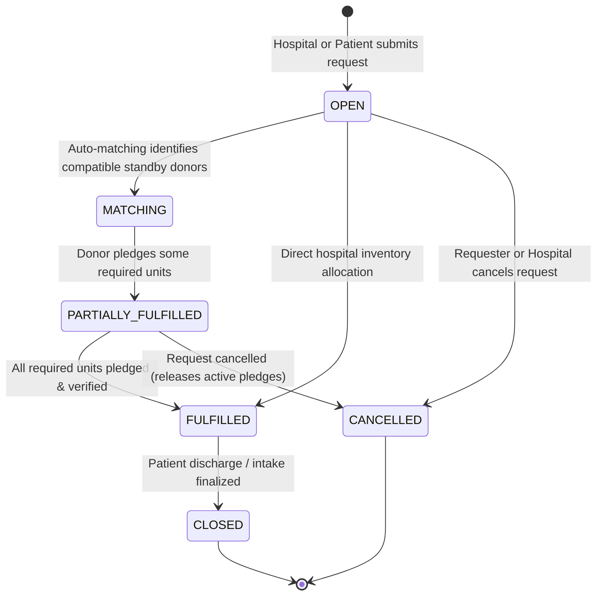
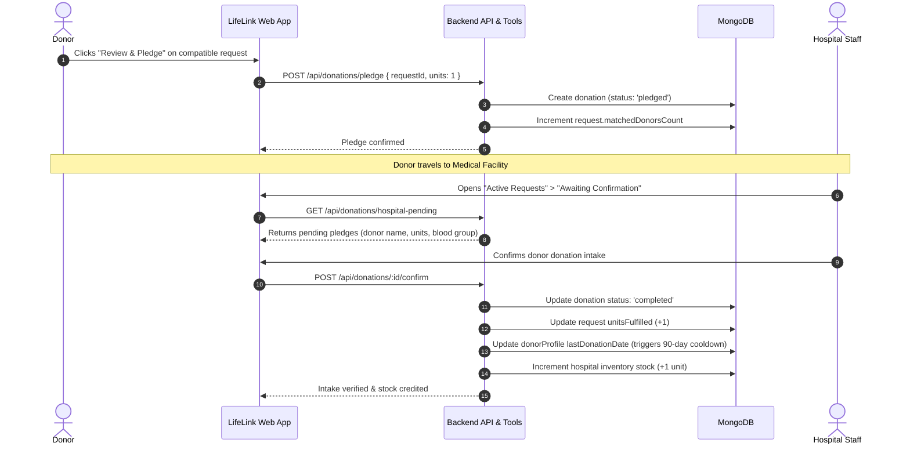

# LifeLink Data Architecture & Domain Model

## 1. Architectural Overview & Data Residency

LifeLink combines cloud-native document persistence, secure tokenized identity, and role-scoped AI tooling:

| Layer | Technology | Residency & Security Policy |
| :--- | :--- | :--- |
| **Primary Database** | MongoDB + Mongoose 9 | Managed via `MONGODB_URI` (`MONGODB_DB_NAME`, default `lifelink`). Unique schema indexes enforce user email uniqueness and single active pledge per donor (`unique_active_pledge_per_donor`). Multi-document ACID transactions (`session.withTransaction`) run on a MongoDB replica set for registration, pledges, request acceptance/cancellation, and inventory allocations. |
| **Identity & OAuth** | Firebase Auth + JWT | Firebase Admin (`firebase-admin/auth`) is used **exclusively** for verifying Google Sign-In ID tokens (`verifyIdToken` + project ID check). Session credentials issue signed 30-day JWTs with role claims (`id`, `accountType`). |
| **Password Storage** | Bcrypt | 10 salt rounds applied to standard email/password registration. Generated random passwords applied to first-time Google OAuth registrations. |
| **AI Assistant** | Google Gemini + Tool Mesh | Tool-only execution. Gemini has zero direct database write permissions. Context-aware server tools enforce role boundaries, data masking (no donor phone/email leaks), and read-only access. |
| **Chat Memory** | Ephemeral Browser State | AI chat history resides in React memory during the user session and is never persisted to MongoDB, protecting user search privacy. |

---

## 2. MongoDB Collections & Mongoose Models Schema

| Collection (`MongoDB`) | Mongoose Model | Key Document Fields & Constraints |
| :--- | :--- | :--- |
| `users` | `User` | `_id`, `name`, `email` (**unique**, lowercase), `password` (hidden by default via `select: false`), `accountType` (`user`, `hospital`, `admin`), `hospitalId`, `phone`, `createdAt`, `updatedAt`. Indexes: `{ email: 1 }` unique, `{ accountType: 1, createdAt: -1 }`. |
| `donorprofiles` | `DonorProfile` | `_id`, `user` (ref `User`, **unique**), `bloodGroup`, `bloodGroupConfirmed`, `isAvailable` (standby), `location` (`2dsphere` GeoJSON `Point [lon, lat]`), `address`, `lastDonationDate`, `healthFlags`, `totalDonations`, `profileComplete`. Indexes: `{ isAvailable: 1, bloodGroup: 1 }`, `{ location: '2dsphere' }`. |
| `hospitals` | `Hospital` | `_id`, `user` (ref `User`, **unique**), `name`, `licenseNumber`, `phone`, `address`, `location` (`2dsphere` GeoJSON `Point [lon, lat]`), `isVerified`, `inventory` (`Array<{ bloodGroup, units }>`). Indexes: `{ isVerified: 1, name: 1 }`, `{ location: '2dsphere' }`. |
| `bloodrequests` | `BloodRequest` | `_id`, `requester` (ref `User`), `hospital` / `targetHospital` (ref `Hospital`), `hospitalName`, `patientName`, `bloodGroup`, `unitsNeeded`, `unitsFromStock`, `unitsFromDonors`, `unitsFulfilled`, `urgency` (`critical`, `high`, `medium`, `low`), `status`, `location` (`2dsphere`), `isEdited`, `editHistory`, `matchedDonorsCount`. Compound indexes on `status`, `targetHospital`, `requester`, `bloodGroup`, `urgency`, and `location` (`2dsphere`). |
| `donations` | `Donation` | `_id`, `donor` (ref `User`), `donorProfile` (ref `DonorProfile`), `request` (ref `BloodRequest`), `hospitalName`, `unitsDonated`, `status` (`pledged`, `completed`, `declined`, `released`, `cancelled`), `completedAt`. **Partial unique index** `unique_active_pledge_per_donor`: `{ donor: 1 }` where `status: 'pledged'`. |
| `inventorytransactions` | `InventoryTransaction` | `_id`, `hospital` (ref `Hospital`), `bloodGroup`, `change` (integer), `reason`, `request` (ref `BloodRequest`), `createdAt`. Indexes: `{ hospital: 1, createdAt: -1 }`, `{ hospital: 1, bloodGroup: 1, createdAt: -1 }`. |
| `donorrequestpings` | `DonorRequestPing` | `_id`, `donorId` (ref `User`), `requestId` (ref `BloodRequest`), `hospitalId` (ref `Hospital`), `status`, `sentAt`, `respondedAt`. Unique compound index `{ requestId: 1, donorId: 1 }`. |
| `notifications` | `Notification` | `_id`, `recipient` (ref `User`), `type`, `title`, `message`, `isRead`, `link`, `expiresAt` (**TTL index**, auto-expires after 30 days), `createdAt`. |
| `aiinsights` | `AIInsight` | `_id`, `title`, `summary`, `metrics` (`highRiskBloodGroups`, `surplusGroups`), `recommendations`, `createdAt`. Index: `{ createdAt: -1 }`. |
| `loginlogs` | `LoginLog` | `_id`, `userId` (ref `User`), `email`, `loginAt`, `ipAddress`, `expiresAt` (**TTL index**, auto-expires after 30 days). |
| `audit_logs` | `AuditLog` | `_id`, `action`, `targetId`, `targetType`, `actor` (ref `User`), `actorRole`, `hospitalId`, `changedFields`, `metadata`, `createdAt`. Indexes: `{ targetId: 1, createdAt: -1 }`, `{ actor: 1, createdAt: -1 }`. |

> Synchronize all schema indexes explicitly with `npm run indexes:sync --prefix server`.

---

## 3. Request & Pledge Lifecycles

### Blood Request Lifecycle

### Donor Pledge Lifecycle

