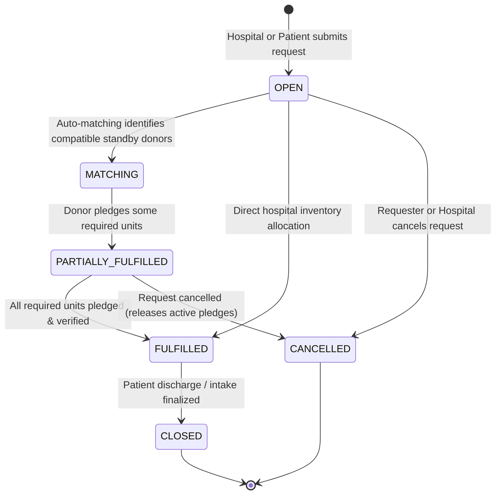

# LifeLink Data Architecture & Domain Model

## 1. Architectural Overview & Data Residency

LifeLink combines cloud-native document persistence, secure tokenized identity, and role-scoped AI tooling:

| Layer | Technology | Residency & Security Policy |
| :--- | :--- | :--- |
| **Primary Database** | Google Cloud Firestore | Real cloud Firestore project (`lifelink-f6f3b`). Atomic multi-document transactions govern email uniqueness (`emails` collection) and request-pledge allocations. |
| **Identity & OAuth** | Firebase Auth + JWT | Google sign-in tokens are verified server-side with `firebase-admin/auth` (`verifyIdToken`). Session credentials issue signed 30-day JWTs with role claims (`id`, `accountType`). |
| **Password Storage** | Bcrypt | 10 salt rounds applied to standard email/password registration. Generated random 24-byte hex passwords applied to first-time Google OAuth registrations. |
| **AI Assistant** | Google Gemini + Tool Mesh | Tool-only execution. Gemini has zero direct database write permissions. Context-aware server tools enforce role boundaries, data masking (no donor phone/email leaks), and read-only access. |
| **Chat Memory** | Ephemeral Browser State | AI chat history resides in React memory during the user session and is never persisted to Firestore, protecting user search privacy. |

---

## 2. Firestore Collections Schema

| Collection | Key Document Fields | Description |
| :--- | :--- | :--- |
| `users` | `_id`, `name`, `email`, `password`, `accountType` (`user`, `hospital`, `admin`), `hospitalId`, `phone`, `createdAt`, `updatedAt` | Core identity document. |
| `emails` | `_id` (normalized email), `userId`, `email`, `createdAt` | Transactional uniqueness lock preventing race-condition duplicate account registrations. |
| `donorProfiles` | `_id`, `user` (ref), `bloodGroup`, `bloodGroupConfirmed`, `isAvailable` (standby), `location` (`Point [lon, lat]`), `address`, `lastDonationDate`, `healthFlags`, `totalDonations`, `profileComplete` | Donor clinical and standby state. |
| `hospitals` | `_id`, `user` (ref), `name`, `licenseNumber`, `phone`, `address`, `location` (`Point [lon, lat]`), `isVerified`, `inventory` (`Array<{ bloodGroup, units }>`) | Verified partner facilities and blood bank stock. |
| `bloodRequests` | `_id`, `requester` (ref), `targetHospital` (ref), `patientName`, `bloodGroup`, `unitsNeeded`, `unitsFulfilled`, `urgency` (`critical`, `high`, `medium`, `low`), `status`, `location`, `matchedDonorsCount` | Emergency clinical demands and fulfillment tracking. |
| `donations` | `_id`, `donor` (ref), `donorProfile` (ref), `request` (ref), `hospital` (ref), `unitsDonated`, `status` (`pledged`, `completed`, `cancelled`), `completedAt` | Donor commitments, hospital intakes, and historical donation records. |
| `notifications` | `_id`, `recipient` (ref), `type`, `title`, `message`, `read`, `link`, `createdAt` | Targeted alerts and emergency broadcast pings. |
| `aiInsights` | `_id`, `title`, `summary`, `metrics` (`highRiskBloodGroups`, `surplusGroups`), `recommendations`, `createdAt` | AI-generated network risk and reserve shortage alerts. |
| `inventoryTransactions` | `_id`, `hospital` (ref), `bloodGroup`, `change` (integer), `reason`, `request` (ref), `createdAt` | Complete audit log of blood stock increments and debits. |
| `loginAuditLogs` | `_id`, `userId`, `email`, `timestamp`, `ipAddress` | Non-blocking security audit trail for user authentication events. |

---

## 3. Request & Pledge Lifecycles

### Blood Request Lifecycle

### Donor Pledge Lifecycle

